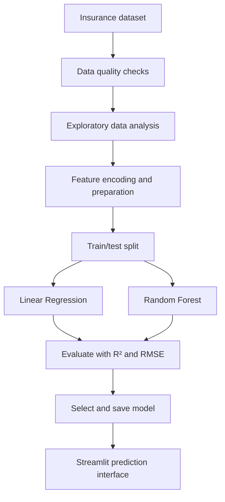

# Medical Insurance Cost Prediction

An end-to-end machine learning project that explores and predicts medical insurance charges from demographic and lifestyle features. It includes an exploratory notebook, a model comparison, and a Streamlit prediction interface.

> **Educational use only.** Predictions are estimates from a historical dataset and are not medical advice, a quote from an insurer, or a basis for real underwriting or pricing decisions.

## Project at a glance

- **Dataset:** 1,338 records
- **Features:** age, sex, BMI, number of children, smoking status, and region
- **Target:** medical insurance charges
- **Models compared:** Linear Regression and Random Forest
- **Evaluation:** R² and RMSE
- **Interface:** Streamlit

## Model results

The results recorded in the project notebook/README are:

| Model | R² | RMSE |
|---|---:|---:|
| Linear Regression | 0.78 | ~5,796 |
| Random Forest | **0.86** | **~4,567** |

Random Forest had the stronger recorded scores on this evaluation. These are historical project results; rerun the notebook to verify them against the current code and environment before comparing model versions.

## Workflow



## Repository contents

- `Medical_Insurance_Cost_Prediction_End_to_End.ipynb` — end-to-end analysis and model comparison
- `app.py` — Streamlit prediction interface
- `insurance_model.pkl` — serialized model artifact

## Run locally

Requires Python 3.10+ and the model artifact included in this repository.

```bash
git clone https://github.com/rohantyagi2225/medical-insurance-ml-project.git
cd medical-insurance-ml-project
python -m venv .venv
```

Activate the environment, then install dependencies and launch the app:

**Windows PowerShell**
```powershell
.venv\Scripts\Activate.ps1
pip install -r requirements.txt
streamlit run app.py
```

**macOS/Linux**
```bash
source .venv/bin/activate
pip install -r requirements.txt
streamlit run app.py
```

To reproduce the analysis, open the notebook in Jupyter or Google Colab and run its cells in order.

## Key observations

- Insurance charges are right-skewed in the commonly used dataset.
- Smoking status is an important predictive feature in the recorded analysis.
- Random Forest captured patterns better than the linear baseline on the reported test metrics.

These are associations in the dataset, not evidence that a feature causes a particular cost.

## Limitations and responsible use

- The dataset is small and historical; results may not generalize to current populations or insurance markets.
- Performance depends on the split, preprocessing, and model artifact version.
- R² and RMSE alone do not establish fairness, stability, or suitability for real pricing.
- Do not use this educational model to make consequential decisions about real people.
- Only load trusted pickle files. Pickle artifacts can execute code when deserialized; retrain from a trusted source if provenance is uncertain.

## Author

**Rohan Tyagi**  
B.Tech, Computer Science and Engineering — Data Science & Machine Learning
