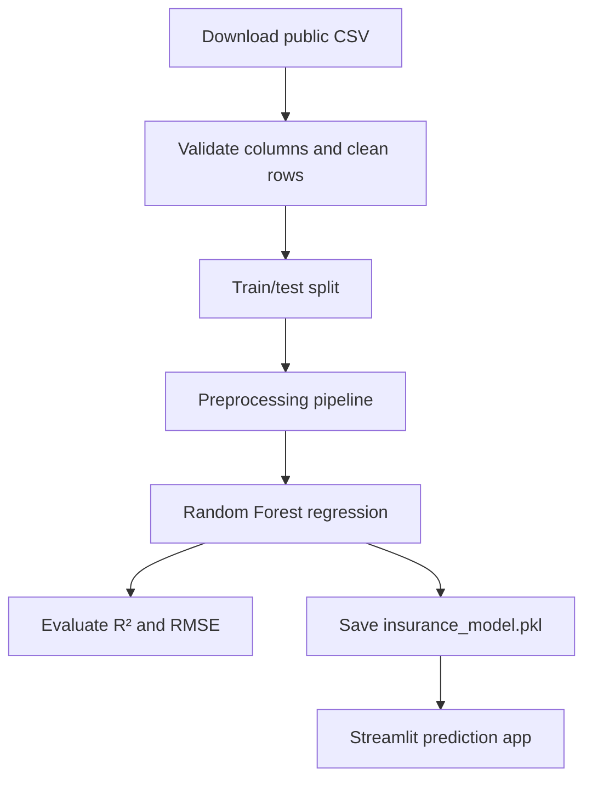

# Medical Insurance Cost Prediction

An end-to-end machine learning portfolio project to estimate historical medical insurance charges from age, BMI, smoking status, number of children, sex, and region. Includes exploratory analysis, regression evaluation, a reusable model pipeline, and a Streamlit interface.

> **Educational use only.** This project is not medical advice, an insurer quote, or a tool for real insurance underwriting or pricing decisions.

## Dataset — no manual upload required

The training script downloads the commonly used Medical Cost Personal Dataset automatically from a public CSV mirror at runtime. You do not need to find or upload `insurance.csv` yourself.

- **Target:** `charges`
- **Features:** `age`, `sex`, `bmi`, `children`, `smoker`, `region`
- **Dataset size:** typically 1,338 records
- **Source URL used by the script:** [insurance.csv](https://raw.githubusercontent.com/stedy/Machine-Learning-with-R-datasets/master/insurance.csv)

The public mirror is a convenience, not a guarantee of permanent availability. Verify the source and dataset schema before using it.

## Workflow



## Quick start — Google Colab or local Python

### 1. Install dependencies

```bash
pip install -r requirements.txt
```

### 2. Train the model (downloads data automatically)

```bash
python train_model.py
```

The script reports held-out test R² and RMSE, then writes `insurance_model.pkl`. The complete preprocessing and model pipeline are saved together, so the app can process the raw user inputs consistently.

### 3. Launch the app

```bash
streamlit run app.py
```

In Google Colab, you can run the training script in a notebook cell with `!python train_model.py`. To run Streamlit in Colab, you need a suitable tunnel or deployment setup; the simplest local run is on your computer.

## Repository contents

- `Medical_Insurance_Cost_Prediction_End_to_End.ipynb` — exploratory analysis and model comparison notebook
- `train_model.py` — reproducible training script with automatic dataset download
- `app.py` — Streamlit prediction interface
- `insurance_model.pkl` — saved model artifact (regenerate with `train_model.py` if it does not match the current pipeline)

## Model evaluation

The notebook contains historical recorded scores for earlier versions of the workflow. Do not treat them as the results of the current training script. Run `train_model.py` to get fresh metrics for the current split, preprocessing, and model version.

## Limitations and responsible use

- The dataset is small and historical; it may not generalize to current populations or insurance markets.
- Correlation and feature importance do not prove causation.
- R² and RMSE do not establish fairness, stability, or suitability for real-world pricing.
- Do not use this educational model to make consequential decisions about real people.
- Only load trusted pickle files: deserializing an untrusted pickle can execute code.

## Author

**Rohan Tyagi**  
B.Tech, Computer Science and Engineering — Data Science & Machine Learning
